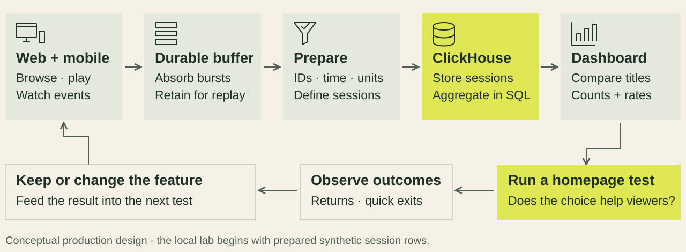
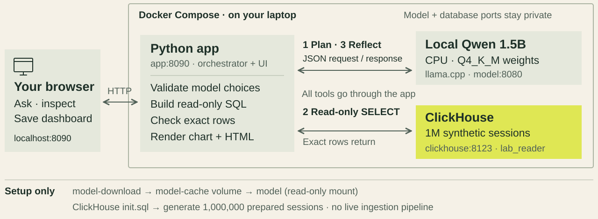

# CampusStream architecture

One homepage slot. Which title earns it—and what evidence supports that decision?

The lecture first traces a **conceptual production system**, then narrows to the **local analytical lab students actually run**. The same SVG diagrams appear in the slides and this repository. CampusStream is a fictional teaching scenario; neither diagram describes a customer's deployment.

## Production: from activity to action

Follow the arrows across the top, then right to left along the bottom:

1. **Create evidence.** Web and mobile clients emit browse, play and watch metadata, not video files. Shared IDs, timestamps and units make the records interpretable.
2. **Absorb arrivals.** A durable buffer decouples producers from consumers and can allow replay within retention. Queue depth and event-to-query delay reveal whether data is arriving faster than it is prepared.
3. **Prepare sessions.** Validate fields, define event/session identity and apply an explicit retry/deduplication policy. Fast SQL cannot repair an incorrect counting rule.
4. **Analyze in ClickHouse.** Store typed sessions, read the columns needed for the question and aggregate counts or rates. Query latency, bytes read and freshness connect architecture choices to analytical cost and usefulness.
5. **Test a business decision.** Compare titles, choose a homepage experiment, observe return visits and quick exits, and keep or change the feature. Those are proposed outcome measures; a high viewing count alone does not establish causal value.

**Scope:** this is a teaching design, not a deployed pipeline or throughput claim. The local lab does **not** implement the clients, queue, live ingestion, sessionization or deduplication stages. It begins with prepared synthetic sessions. The lecture's daily event-volume estimate and the lab's session-row count are different quantities.

## Local lab: what runs on a laptop

The numbered requests are the order of one investigation. Every model and database call is mediated by the Python app:

1. **Plan.** The browser sends a question to `POST /api/run`. The app asks the local model for a typed JSON plan, then validates the metric, grouping, title and threshold against supported values. The model does not produce executable SQL or shell code.
2. **Query.** The app constructs a bounded `SELECT` and calls ClickHouse as `lab_reader`. The table returns exact rows. Python computes the numeric observation, including ranking and ties, from those rows.
3. **Reflect and build.** The app supplies the verified observation to the model for a proposed limitation and next test. It validates that response and builds escaped HTML and chart values from the actual results. Model prose is evidence to challenge, never executable code. The browser displays the result and can save a standalone HTML dashboard.

### Deployment boundaries

| Component | Responsibility | Reachability / state |
|---|---|---|
| Student browser | Prediction, controls, question, chart, SQL/row inspection, HTML download | Only host endpoint: `http://localhost:8090` (bound to `127.0.0.1`) |
| `app` | Python standard-library HTTP server, plan validation, SQL tool, verified observation and dashboard generation | Docker service `app:8090`; connects to the two private services |
| `model` | CPU inference using Qwen2.5-Coder-1.5B-Instruct, Q4_K_M, served by llama.cpp | Internal `http://model:8080`; no host-published port; model cache mounted read-only |
| `clickhouse` | `campusstream.sessions`: 1,000,000 synthetic rows, MergeTree sorted by `(title, event_time)` | Internal `http://clickhouse:8123`; no host-published port; app uses SELECT-only `lab_reader` |
| `model-download` | First-setup download and checksum verification | One-shot service; writes named `model-cache` volume, then exits |
| `clickhouse/init.sql` | Generate deterministic prepared sessions at database initialization | Batch input, not a live event stream; recreated database starts again from this data |

The model has **no direct connection to ClickHouse**. The app builds SQL only from validated choices. `lab_reader` has SELECT access to this table, a five-second execution limit, two query threads, a 256 MiB query-memory limit and at most 100 result rows. These are local classroom controls, not a production security design.

### Startup and resource model

Setup downloads pinned container images and a checksum-verified model; it needs internet. `model` starts after the downloader succeeds. The app waits for ClickHouse's million-row health check, and the setup script waits for the app's combined model/database readiness. After downloads, inference and query execution stay local; no external AI account or API key is required.

Three services remain running after setup: app, model and ClickHouse. Container caps total **3,716 MiB (3.63 GiB)** including the one-shot downloader: model 2,300; ClickHouse 1,000; app 256; downloader 160. This is a container workload budget, not total laptop or Docker VM RAM. Docker Desktop and the host OS need additional memory. See [TESTING.md](TESTING.md) for actual platform/resource test coverage; these diagrams add no new runtime certification.

The named model cache survives `docker compose down`. ClickHouse's synthetic table is rebuilt when its container is recreated; there is no persistent database volume in this lab. Save a dashboard to your laptop before stopping the app.

## Read the implementation

- [compose.yaml](compose.yaml): services, dependencies, loopback port, private endpoints, volume and memory caps.
- [app.py](app.py): `run_agent`, `validate_plan`, `query_for`, `query_clickhouse`, `dashboard` and `/api/run` request handling.
- [clickhouse/init.sql](clickhouse/init.sql): table contract, deterministic session generator and read-only database identity.
- [download_model.py](download_model.py): pinned model source and checksum verification.
- [README.md](README.md): macOS/Windows preflight, setup, postflight and the twenty-minute investigation.

## Explain it to the room

On the production diagram, ask: “Where would you absorb a traffic spike, and where would you fix repeated events?” Then follow one record into the title comparison and a measurable homepage test.

On the local diagram, ask: “Which component is allowed to query the database, and where do the chart's numbers come from?” Trace **1 plan → 2 query → 3 reflect**, then have students inspect those same stages in the app. A session is not a unique viewer; engaged means a chosen watch-time threshold, not satisfaction. A candidate title still needs a fair experiment.

## References

- [ClickHouse: column-oriented analytics](https://clickhouse.com/docs/get-started/about/intro)
- [Docker Compose: startup dependencies](https://docs.docker.com/compose/how-tos/startup-order/)
- [llama.cpp server APIs](https://github.com/ggml-org/llama.cpp/blob/master/tools/server/README.md)
- [Qwen model source](https://huggingface.co/Qwen/Qwen2.5-Coder-1.5B-Instruct-GGUF)

The diagrams are editable, self-contained SVGs under [docs/](docs/). Keep their slide copies identical when updating the architecture.
