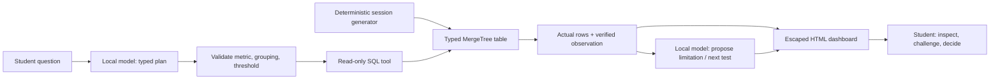

# CampusStream: make the AI show its evidence

A twenty-minute Big Data Architecture lab: ask a small local model to plan an investigation, execute a bounded ClickHouse tool, and build a downloadable HTML dashboard. One million synthetic viewing sessions; one homepage decision. No external AI API, API key, GPU or host Python/Node install.

## Start on Windows or macOS

Student repository: **https://github.com/maruthiprithivi/big_data_architecture/tree/main/labs/campusstream-agent-lab**

Download **[the lab-only ZIP](https://github.com/maruthiprithivi/big_data_architecture/releases/download/campusstream-lab-v1.0.1/campusstream-agent-lab.zip)**, then **extract** it. No Git installation is required. Open the extracted `campusstream-agent-lab` folder containing `compose.yaml` in Terminal (macOS) or PowerShell (Windows).

If you already cloned the course repository, open `labs/campusstream-agent-lab` instead. The lab's own Compose file and scripts run independently of the blockchain lab at the repository root. Run the commands below from the lab folder.

Install and start Docker Desktop before the session. Windows uses **Linux containers with WSL 2**. Use the Intel/Apple Silicon Docker Desktop edition matching your Mac. Set Docker/WSL memory to at least **4 GiB**; the laptop OS needs additional RAM. Then run **one command per action**:

| Action | macOS · Terminal | Windows · PowerShell |
|---|---|---|
| Check prerequisites | `bash lab.sh preflight` | `powershell -NoProfile -ExecutionPolicy Bypass -File .\lab.ps1 preflight` |
| Set up and wait until ready | `bash lab.sh setup` | `powershell -NoProfile -ExecutionPolicy Bypass -File .\lab.ps1 setup` |
| Verify the whole lab | `bash lab.sh postflight` | `powershell -NoProfile -ExecutionPolicy Bypass -File .\lab.ps1 postflight` |

**Start with setup:** it already runs preflight. Preflight is read-only: checks Docker CLI/Compose, a running Linux engine, supported ARM64/AMD64 CPU, reported engine memory covering 3,716 MiB (configure at least 4 GiB; Linux reserves some) and valid Compose configuration. Setup builds/starts this lab and waits up to ten minutes after startup for actual model/database readiness. A failed step returns a nonzero exit status and a recovery message. Running the script from another directory is supported; paths with spaces are tested.

Open **http://localhost:8090** after `READY`. First start needs internet and downloads pinned images plus **1,117,320,768 bytes** of model weights, verified by SHA-256. Allow several minutes on classroom Wi-Fi. Subsequent starts reuse the named model cache. No host Python/Node, GPU, API key or model account is needed. Docker Desktop installation can require administrator privileges/restart. The Windows command's execution-policy override applies only to that process; it does not alter your saved policy. If organizational policy blocks Docker/scripts, use the lecture's browser-only fallback.

Container limits: model 2,300 MiB, ClickHouse 1,000 MiB, app 256 MiB, one-shot downloader 160 MiB. Sum **3,716 MiB (3.63 GiB)**, within the **4 GiB container workload budget**. Only three services run after setup. This is not total laptop RAM; Docker Desktop/OS need additional memory. Windows Docker Desktop specifies at least 8 GB host RAM. No GPU memory is required. Resource tests and their limits are recorded in `TESTING.md`.

## The challenge

1. **Predict — 3 min.** Choose the most-started movie before asking.
2. **Explore — 6 min.** Compare starts, engaged-session count and engagement rate. Inspect the plan, SQL and query rows. Swap the driver.
3. **Build — 6 min.** Change a grouping or threshold, then download and open the dashboard HTML.
4. **Defend — 5 min.** Give a 30-second recommendation, business aim, limitation and next experiment.

Try:

```text
Compare starts by title and build a dashboard.
Rank titles by engaged sessions using a 20-minute threshold.
Which title has the highest engagement rate? Use a 20-minute threshold.
Compare engagement rate by device, using a 40-minute threshold.
```

Tools support title/device/day, starts/engaged_sessions/engagement_pct, and 60/600/1200/1800/2400 second thresholds. The local model chooses a typed plan. The application validates it, constructs SQL, executes the read-only database tool, and sends a verified numeric observation back to the model for a proposed limitation and next test. It builds escaped HTML and charts from actual rows. Generated prose is never executed as SQL, JavaScript or shell code. This is an analytics/build agent, not a general coding assistant.

The numeric observation is derived from query rows, including ties. A small model initially misread a ranking in testing; keeping arithmetic and ranking in the tool is a deliberate architecture choice. Inspect model-selected metrics and proposed interpretations rather than treating them as facts.

## Follow the data



The source is a batch generator, not a live stream. `event_time` and `ingested_at` illustrate event/arrival time; no queue, source collector or deduplication pipeline is implemented. `session_id`, typed fields, a sorting key and separate query/model/app services connect to the overall IS459 module. Discuss ingestion contracts, burst buffering, bad/duplicate events, freshness, column scans, query design and dashboard decisions in the lecture. The lab directly exercises the query-to-decision portion.

## Data contract and expected evidence

One row is **one session**, not a unique user. One million deterministic rows cover four titles, two devices and ten fixed UTC dates. Watch time is either 60 or 1,800 seconds. Default engaged means `watch_seconds >= 1200` (20 minutes), not completion.

| Title | Starts | Engaged sessions | Rate |
|---|---:|---:|---:|
| The Matrix | 500,000 | 100,000 | 20% |
| Apollo 13 | 300,000 | 240,000 | 80% |
| Sleepless in Seattle | 100,000 | 60,000 | 60% |
| Cloud Atlas | 100,000 | 90,000 | 90% |

At 30 minutes, the engaged set is unchanged. At 40 minutes, all engaged counts/rates are zero: a tie. There is no equal-exposure, unique-viewer, satisfaction, revenue or causal-uplift evidence. Return visits and quick exits are proposed experiment measures, not measured gains. The lab does not train a recommender or benchmark production throughput.

## Verify, troubleshoot, stop

Run the **postflight** command above to test four real local-model investigations, expected rows/rankings/ties, input/plan validation, database write denial, cross-origin rejection and escaped HTML export. It saves **`results/postflight.json`** and a working **`results/dashboard.html`** on your laptop only after all checks pass. Open the dashboard in a browser; it includes the executed SQL. The files are overwritten on a later successful postflight. Keep your own student dashboard under a different name.

Postflight leaves the lab running. It is verification, not cleanup. The underlying portable test remains `docker compose exec -T app python verify.py`.

```text
docker compose ps -a
docker compose logs --tail 30 model-download model clickhouse app
docker compose down
```

`down` preserves the named model cache. The synthetic database is rebuilt when its container is recreated; it holds no student work. Download dashboards before removing the app. If port 8090 is already occupied, stop the other lab using it. If download fails, rerun startup; a partial file is replaced and its checksum checked. If inference is slow, use one question at a time and fewer browser tabs; do not increase model context or swap in larger weights during class. The app is loopback-only; neither ClickHouse nor the model has a host-published port. Only use this as a local classroom app, not an internet service.

## Pinned sources

- Model: https://huggingface.co/Qwen/Qwen2.5-Coder-1.5B-Instruct-GGUF (Apache 2.0), revision `f86cb2c1fa58255f8052cc32aeede1b7482d4361`, Q4_K_M SHA-256 `cc324af070c2ecbfd324a30884d2f951a7ff756aba85cb811a6ec436933bb046`.
- Multi-platform CPU server: https://github.com/ggml-org/llama.cpp/blob/master/docs/docker.md
- Structured JSON and health API: https://github.com/ggml-org/llama.cpp/blob/master/tools/server/README.md
- ClickHouse column storage: https://clickhouse.com/docs/get-started/about/intro
- Compose readiness: https://docs.docker.com/compose/how-tos/startup-order/
- Windows: https://docs.docker.com/desktop/setup/install/windows-install/
- macOS: https://docs.docker.com/desktop/setup/install/mac-install/
- Multi-platform testing/emulation: https://docs.docker.com/build/building/multi-platform/

Docker images are pinned to multi-platform digests in `compose.yaml` and `Dockerfile`. Review pins before a future teaching run. Source facts checked 20 October 2026. Self-hosted DM Sans is distributed with its license under `web/FONT-LICENSE.txt`.
